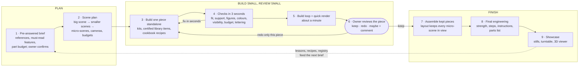

# How the builds are made

A sentence goes in; a LEGO model comes out that a person can actually build: every part exists in its colour, every connection is checked, it stands on a table, and it comes with a parts list and step-by-step instructions. This page explains how we get there, and why the process looks the way it does.

| | |
|---|---|
| **7 – 2** | blind picks won against Claude Opus in BrickAgent, 9 subjects |
| **9 → 1–2** | build loops to an acceptable result, first ents vs later items |
| **~150 s → 3 s** | cost of catching a design mistake, after vs before building |
| **$86 → $26** | cost per winning build (list-price equivalent) |

## What we add

- **Buildable, proven.** A language model can describe a castle; it cannot tell you whether brick 4,812 floats. Our engine places real LDraw parts on a grid, checks connections, colour availability and collisions, and solves the model for strength before calling it buildable.
- **Taste that compounds.** Every blind pick and every comment from the owner becomes a written taste rule, a lesson or an automated check. The next build starts where the last one ended.
- **Scenes, not objects.** A set is a big scene made of a few smaller scenes, each with a dominant figure, and many small micro-scenes to discover: a gløgg stall, a lamplighter on his ladder, Bilbo with his pipe.
- **Ready to build.** Each finished set has a parts list by part and colour, a readable instruction booklet, the model file for BrickLink Studio, and calibrated renders where colours look like real plastic.

## The process

The owner's eye is the scarce resource, so the process spends it on small pieces that are easy to judge, and spends the machine's time on everything that can be checked automatically.

The loops back are cheap: a failed check costs seconds, a redo touches one piece. The dotted loop is how the next set starts better than this one.

## Why this way, and what we tried first

Most of the current process exists because an earlier version failed in a way we measured. 43 short, timed experiments changed one thing at a time and kept what the numbers supported.

| Choice | What we tried first | What we do now |
|---|---|---|
| Unit of work | Build the whole scene at once: 17 build loops over 7 scene experiments, none judged better than partial. | Build and review each smaller scene or item on its own: items reach acceptable in 1–2 loops. |
| Owner feedback | One verdict on a full model, hard to act on. | Keep / redo / maybe per piece; every redo comment becomes a tracked lesson. |
| Catching mistakes | After a 35–164 s pre-flight or a full build. | Before building, in about 3 s: support, figures, colour count, visibility, part budget, sign lettering. |
| Generating a model | A language model writes the parts directly (the BrickAgent baseline): fast, but nothing guarantees it builds. | The model designs, the engine places real parts and proves them. Won 7 of 9 blind picks. |
| Learning | Lessons in notes that the next builder may not read. | A lessons ledger, a cookbook of 130+ recipes and a registry of every build's scenes, so a better bike or tree is carried to every set that has one. |
| Renders | GPU path-tracing: 14 % of runs crashed the GPU; dark colours rendered grey. | Fast previews for design, CPU path-tracing with denoising for the showcase, colours calibrated to within 0.04 of real LEGO. |
| Turntables | Render every third frame and interpolate: busy models smeared. | Render every frame for detailed sets. |
| Big models | One crowded scene; a flat back wall read like a theatre set. | A scene plan with a layout solver that keeps every micro-scene visible from its camera. |

## How we judge a build

No single number says a model is good, so we measure it in layers, from "can it exist" to "does the owner love it". The automated measures are calibrated against official LEGO sets (148–156 models from the LDraw library), so "good" means "within the range real sets fall in", not a guess.

| Layer | Question | How it is measured |
|---|---|---|
| Verdict | Does the owner prefer it? | Blind X/Y picks against Claude Opus in BrickAgent *and* against our previous version (a new version must not lose what won); keep / redo / maybe on each piece. A sealed critic writes its pick before the owner does (82 % agreement on past pairs); reported, never a gate. |
| Buildable | Can someone actually build it? | Every part exists in its colour; connections mate; nothing collides or floats; it stands on a table (a strength solve with a margin); every instruction step can be placed in order; an independent checker (BrickAgent) agrees. |
| Reads at a glance | Do the things that matter show up? | Each must-read feature (a face, a sign, the dominant figure) is measured in the review camera: size in pixels, how much is hidden, which way it faces, contrast, proportion. Every micro-scene must be seen by its camera; each smaller scene's dominant must be the largest thing in it. |
| Looks like LEGO | Is it shaped and coloured the way real sets are? | A colour count within what official sets of the same size use; calm, consistent palettes; slopes and curves on silhouettes rather than bare stairs; touching structures that differ in colour or part family; enough special parts instead of plain bricks. |
| Fun to build | Is building it interesting from bag to bag? | Build entropy per section against official-set bands (variety of part types, colours, lengths and techniques; how often a step brings something new; how long it stays monotonous). Every bag ends in a reveal. The booklet shows each step's new parts clearly. |
| Novel and surprising | Does it use parts cleverly? | Parts used beyond their usual role, learned from official sets (a fez as a tree top, a claw as a palm frond, aeroplane wings as fir boughs). Diversity within a kind: no two ents, trees or fire pits the same. |
| Alive and specific | Is it this subject, and is something happening? | The owner's taste rules (22 so far, each traced to a verdict): integrated scenes, depth instead of a theatre box, a story moment, recognisable sculptures, creatures with their defining traits, a lot happening, a city's at-first-sight giveaways, snow that does not merge ground and roofs. |
| Process | Are we getting better and faster? | Build loops to an acceptable result per kind of thing; mistakes caught before building; the share of findings knowable in advance; time per loop; cost per winning build; render colour accuracy. |

## What comes next

- Rebuild the seven sets here with this process, one at a time, each new version tested blind against the current one before it replaces it.
- Pilot the building instructions on small builds first, then publish a full parts list (CSV and a BrickLink wanted list) and the instructions for every set.
- Christmas in Copenhagen, assembled from the reviewed pieces.

Numbers come from the project's experiment ledger and blind-pick records, October 27 – November 2, 2026. Costs are list-price equivalents of subscription usage.
