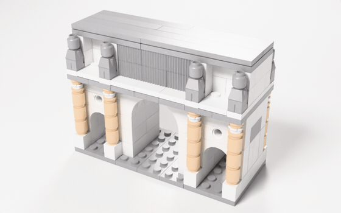
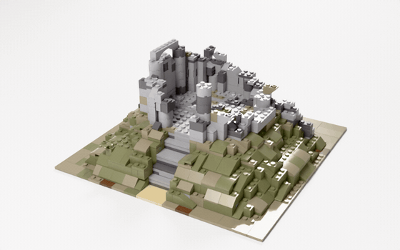
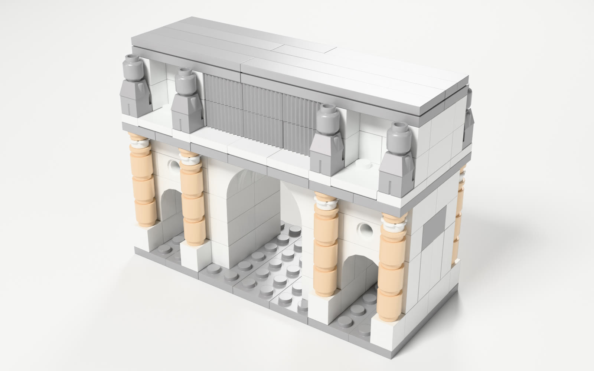
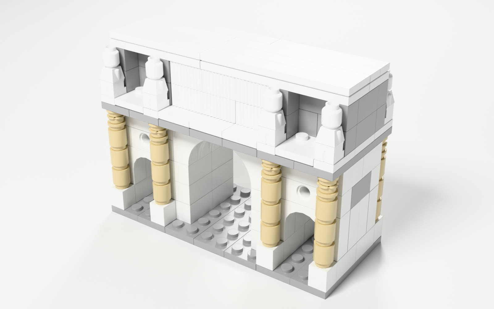
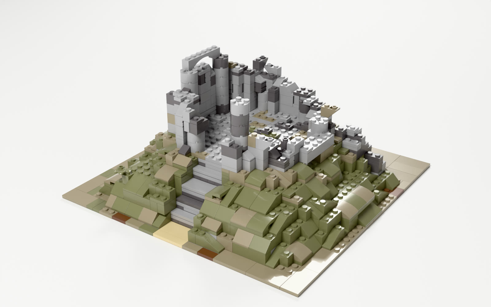
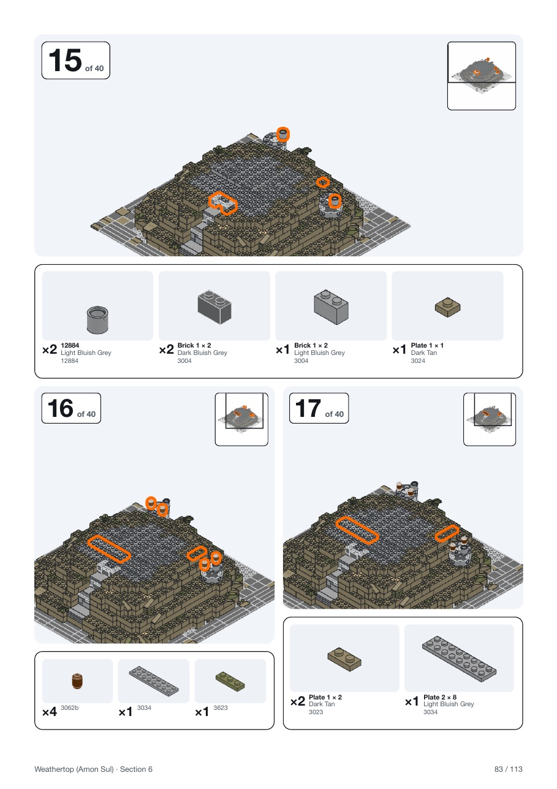
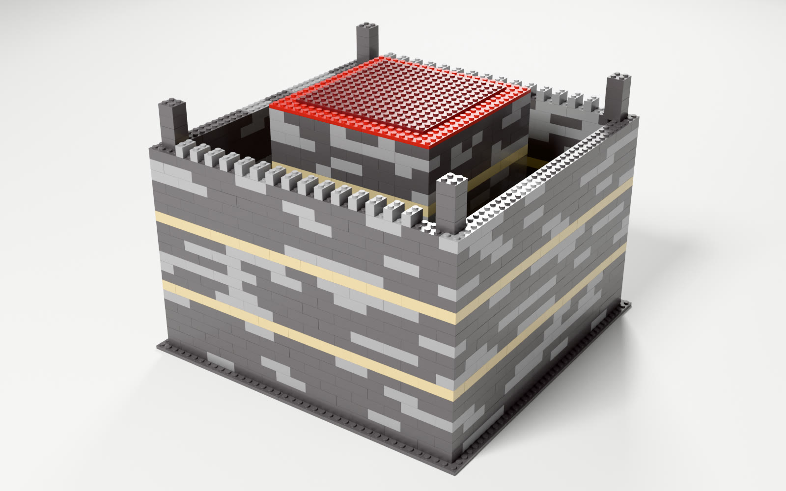

# text-to-brick: sample builds

Sample models from **text-to-brick**, a research project that turns a description into a brick model you can actually build: every part exists in its colour, every connection is checked, and the model is solved for strength before it is called buildable. Each sample comes with the parts file, a turntable, an interactive 3D view, and a note on what is good and what is weak.

**[▶ Open every model in interactive 3D](https://jakubchudik.github.io/text-to-brick-showcase/)**: drag to orbit, scroll to zoom, in the browser.

> Independent, non-commercial fan project. Not affiliated with, sponsored or endorsed by the LEGO Group. LEGO® is a trademark of the LEGO Group. The models use the community LDraw parts library (CC BY 4.0 / CC BY 2.0).

| Arch of Constantine | Weathertop |
|---|---|
|  |  |

## How to open the models

Every `.ldr` file is a standard [LDraw](https://www.ldraw.org/) model. It opens in **BrickLink Studio**, **LeoCAD** or **LDView** with every part, colour and position; Studio can also price it and export a parts list. The `.glb` files in `docs/models/` are the same models for any 3D viewer (bricks fully enclosed by other bricks are left out to keep them small).

## Builds

| # | Build | Parts | Verdict |
|---|---|---|---|
| 1 | [Arch of Constantine](#1-arch-of-constantine) | 202 | Good: passes two independent checkers |
| 2 | [Weathertop](#2-weathertop) | 1,107 | Good: every check passes, instructions generated |
| 3 | [The fortress](#3-the-fortress-what-bad-looks-like) | 2,012 | Bad: buildable and boring |

---

## 1. Arch of Constantine

| Option b: Light Nougat columns | Option a: Tan columns, grey attic |
|---|---|
|  |  |

[Turntable a](builds/turntables/arch-a.gif) · [Turntable b](builds/turntables/arch-b.gif) · [3D](https://jakubchudik.github.io/text-to-brick-showcase/#arch-b) · `arch-a.ldr`, `arch-b.ldr`: 202 parts, 19 designs.

**Good**
- 44 % special parts: real arch pieces, round-brick columns with Corinthian leaf capitals, a grille-brick inscription, round tondi and 8 microfigure statues.
- Strength margins of 0.97 sitting on a table, 1.00 lifted and 0.99 carried, and a pass from BrickAgent's independent `check()`.
- A certified block: larger scenes place it as a unit.

**Weak**
- At this scale the statues are generic microfigures, not portraits, and the relief panels are flat recesses.

## 2. Weathertop

| Studio render | A page from a generated instruction booklet |
|---|---|
|  |  |

[Turntable](builds/turntables/weathertop.gif) · [3D](https://jakubchudik.github.io/text-to-brick-showcase/#weathertop) · `weathertop.ldr`: 1,107 parts. The booklet page comes from a larger build of the same hill.

**Good**
- Every check passes: geometry, connections, part-in-colour availability and the clutch-aware strength solve. Margins: 0.83 sitting on a table, 0.98 lifted by the base, 0.95 carried.
- Real bonding: only 7 % of vertical seams line up (a running bond), and 58 % of bricks rest on two or more bricks below.
- Generated instructions: steps grouped into bags, callouts for new parts, a parts list per step, plus a full parts list and a BrickLink order list.
- Inside the official-set range on 6 of 7 build-experience components (below).

**Weak**
- Placement patterns are below the official range: few sideways-mounted (SNOT) and offset placements.

## 3. The fortress: what bad looks like

[Turntable](builds/turntables/fortress.gif) · [3D](https://jakubchudik.github.io/text-to-brick-showcase/#fortress) · 2,012 parts. **Perfectly buildable and no fun to build.**

- 88 % of its parts sit in runs of six or more identical touching parts, from only 7 different part designs.
- Build-experience score **0.14**, against **0.64** for Weathertop; outside the official-set range on 6 of 7 components.

---

## How it compares with existing work

The open field in 2026: **BrickGPT** (CMU, ICCV 2025 best paper), **StableLego**, **BrickNet** and **BrickAgent / BrickBench** (2026), **LegoACE**, **brick-mcp-app**, **LDraw-Nova**, **Brickomancer**, and the legolization papers (EPFL 2013, SIGGRAPH Asia 2015).

### Adopted directly

| From | What is used |
|---|---|
| LDraw | File format, parts library, colour codes. Every model opens in Studio, LeoCAD and LDView |
| brick-mcp-app, BrickGPT | Integer stud grid with height in plates. A tool contract for language models: place a batch, get a result per row with repair hints |
| StableLego, BrickGPT | The force-balance model of stability, with a clutch force of 0.98 N per stud contact |
| EPFL 2013, BrickGPT `mesh2brick` | Lay bricks greedily layer by layer, then split and re-merge weak spots found in the connection graph |
| BrickGPT | Reject and roll back: generate, check, repair, and never keep an unchecked step |
| BrickAgent / BrickNet | Their checker as an independent second opinion, and their part connector data for detail parts |

### Improved on

| Area | Existing work | text-to-brick |
|---|---|---|
| **Strength** | Support-only checks (brick-mcp-app), rigid bodies (BrickAgent), or none (LDraw-Nova) | A force-balance solve that knows clutch can fail, checked three ways (sitting on a table, lifted by the base, carried), plus detection of single-stud weak links. It flags models that rigid-body checks pass |
| **Solver** | Gurobi, a commercial licence (BrickGPT, StableLego) | The same formulation on an open solver (HiGHS), run in parallel |
| **Scale and parts** | 8 brick types on a 20×20×20 grid (BrickGPT) | A 669-part catalogue: slopes, rounds, arches, sideways mounting, figures. Models up to about 7,000 parts |
| **Colour** | Free hex colours, or any colour code | Every part is checked to exist in its colour; colour rules are measured on official sets |
| **"Fun to build"** | Not measured | A 7-component build-experience metric, calibrated per bag on 148 official sets |
| **Deliverable** | A model file, sometimes instructions (Brickomancer) | Model, step-by-step booklet, parts list, BrickLink order list |
| **Verdicts** | Pass or fail | A check that cannot run says *not checked*, never *pass* |

### Where existing work is still ahead

- **Part coverage:** BrickNet represents 93 % of the parts in official sets, text-to-brick 59 %; hinges, clips, balls and axles are not expressible yet.
- **Speed:** a coding agent in BrickAgent builds a 2,000-part model in about 15 minutes; the final strength solve here on a 7,000-part model takes 40–75 minutes.
- **Exact geometry:** the stud grid flags some inverted slopes over studs as overlapping, which BrickNet's exact part shapes correctly allow.

## The numbers behind "good"

- **Build experience:** 7 normalised entropy components (part types, colour, lengths, placement patterns, surface, novelty per step, monotony), each banded per bag of about 200 parts on **148 official sets** from the LDraw Official Model Repository (494 bags). The bands describe what is typical of official sets.
- **Strength:** margins from 0 (fails) to 1 for sitting on a table, being lifted and being carried. A model counts as buildable only if every check ran and passed.

## How the pictures are made

Stills and turntables are path-traced in Blender Cycles from the same model files, with one studio HDRI, one softbox and a fixed exposure; bricks get 0.25 mm bevels and plain studs (no logos). The interactive page uses Google's `<model-viewer>` on the exported `.glb`. Script: `tools/cycles-turntable.sh`.
