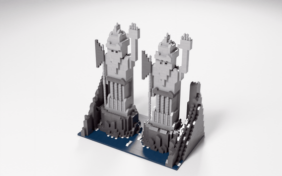
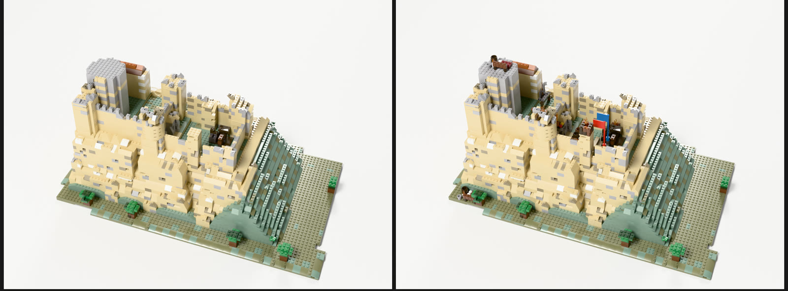
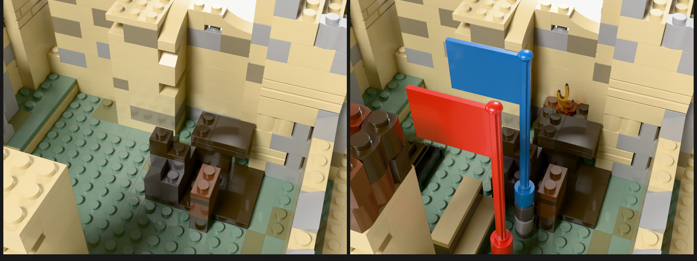
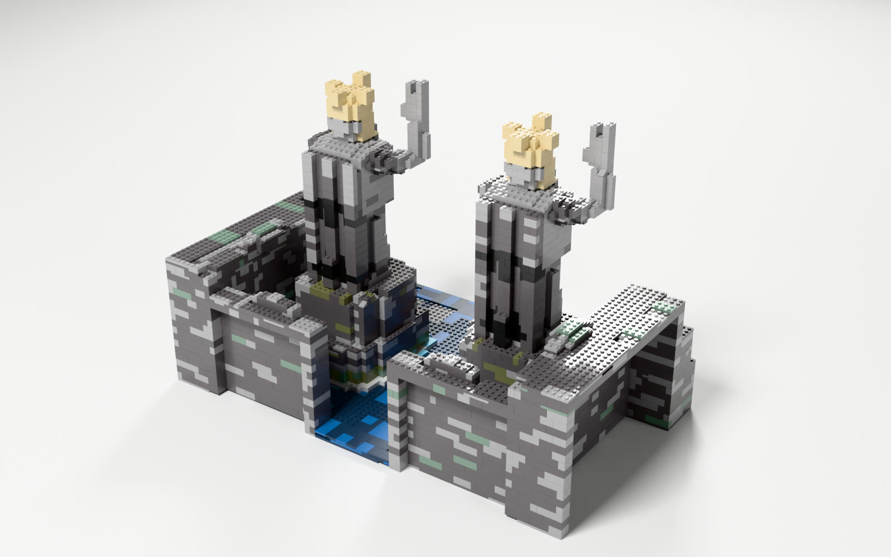
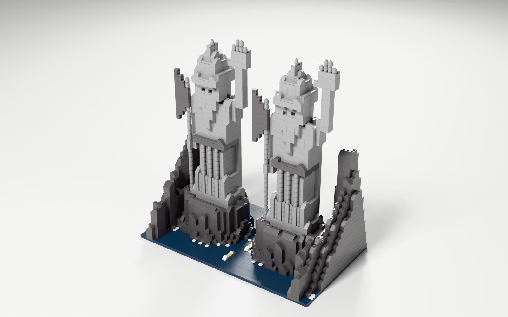
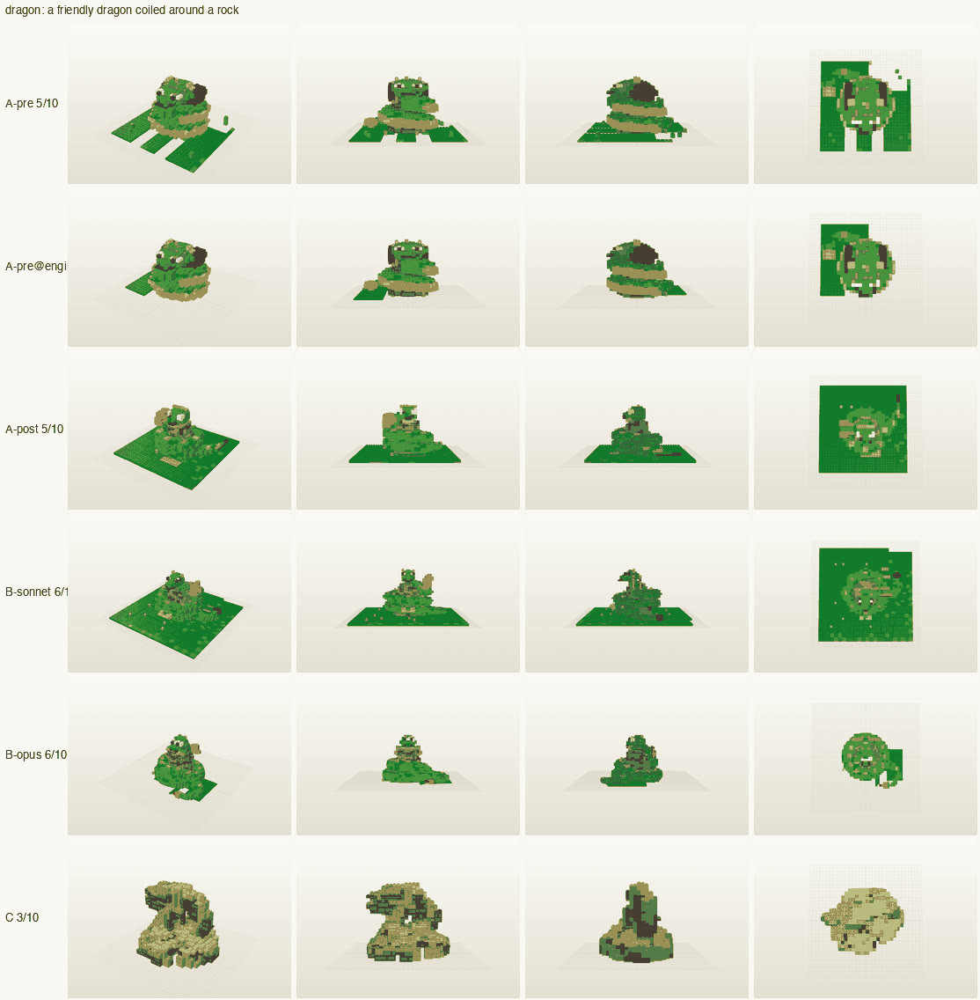

# text-to-brick: sample builds, what works, and what doesn't

Sample models from **text-to-brick**, a personal research project (October 2026) that turns a description into a brick model you can actually build. Each sample comes with the parts file, a turntable, an interactive 3D view and an honest note on what is good and what is bad about it.

The second half compares the project with existing open work: what it **adopts directly**, what it **improves on**, and where the existing work is **still better**.

**[▶ Open every model in interactive 3D](https://jakubchudik.github.io/text-to-brick-showcase/)**: drag to orbit, scroll to zoom, in the browser.

> Independent, non-commercial fan project. Not affiliated with, sponsored or endorsed by the LEGO Group. LEGO® is a trademark of the LEGO Group. The models use the community LDraw parts library (CC BY 4.0 / CC BY 2.0).

| Arch of Constantine | Weathertop | Argonath (coding agent) |
|---|---|---|
|  |  |  |

## How to open the models

Every `.ldr` file is a standard [LDraw](https://www.ldraw.org/) model. It opens in **BrickLink Studio**, **LeoCAD** or **LDView** with every part, colour and position. Studio can also price the model and export a parts list. The `.glb` files in `docs/models/` are the same models for any 3D viewer; bricks fully enclosed by other bricks are left out to keep them small.

## Contents

| # | Build | Parts | Verdict |
|---|---|---|---|
| 1 | [Arch of Constantine](#1-arch-of-constantine-a-certified-sub-assembly) | 202 | Good: passes two independent checkers |
| 2 | [Weathertop](#2-weathertop-a-complete-build-with-instructions) | 1,107 | Good: every check passes, instructions generated |
| 3 | [Spiš castle: details A/B](#3-spiš-castle-small-scene-details-blind-ab) | about 5,200 | Good: the details won a blind test 5 of 5 |
| 4 | [The fortress](#4-the-fortress-what-bad-looks-like) | 2,012 | Bad: buildable and boring |
| 5 | [Argonath: ours vs a coding agent](#5-argonath-ours-vs-a-coding-agent) | 5,293 vs 2,224 | The agent won the blind pick, but fails our strength check |
| 6 | [A friendly dragon](#6-a-friendly-dragon-recognisable-not-lifelike) | – | Bad: a green mound |

---

## 1. Arch of Constantine: a certified sub-assembly

| Option b: Light Nougat columns | Option a: Tan columns, grey attic |
|---|---|
|  |  |

[Turntable a](builds/turntables/arch-a.gif) · [Turntable b](builds/turntables/arch-b.gif) · [3D](https://jakubchudik.github.io/text-to-brick-showcase/#arch-b) · `arch-a.ldr`, `arch-b.ldr`: 202 parts, 19 designs.

**Good**
- 44 % special parts: real arch pieces, round-brick columns with Corinthian leaf capitals, a grille-brick inscription, round tondi and 8 microfigure statues.
- **Passes two independent checkers**: ours, with strength margins of 0.97 sitting on a table, 1.00 lifted and 0.99 carried, and BrickAgent's `check()`.
- It is built once and reused: the engine places it into larger models as a certified block.

**Bad**
- At this scale the statues are generic microfigures, not portraits, and the relief panels are flat recesses.

## 2. Weathertop: a complete build with instructions

| Studio render | A page from a generated instruction booklet |
|---|---|
|  |  |

[Turntable](builds/turntables/weathertop.gif) · [3D](https://jakubchudik.github.io/text-to-brick-showcase/#weathertop) · `weathertop.ldr`: 1,107 parts. This is the reference build that runs in every test pass. The booklet page comes from a larger build of the same hill.

**Good**
- **Every check passes:** geometry, connections, part-in-colour availability, and the clutch-aware strength solve. Margins are 0.83 sitting on a table, 0.98 lifted by the base, and 0.95 carried.
- Real bonding: only 7 % of vertical seams line up (a running bond), and 58 % of bricks rest on two or more bricks below.
- Instructions are generated: steps grouped into bags, callouts for new parts, a parts list per step, plus a full parts list and an order list for BrickLink.
- On the "fun to build" metric (below) it sits inside the official-set range on 6 of 7 components.

**Bad**
- Placement patterns are still below the official range: too few sideways-mounted (SNOT) and offset placements.

## 3. Spiš castle: small-scene details, blind A/B

| Whole model, A (as generated) vs B (with details) | Courtyard close-up |
|---|---|
|  |  |

A detail pass finds courtyards, hearths and gates and fills them with small scenes from a certified library: flags, a fire, a well, furniture.

**Good**
- **B was preferred in 5 of 5 blind pairs** and became the default.
- Costs +2.6 % parts, under a hard 10 % cap. Across the two test models there were 0 collisions, and 219 of 219 parts sat on real studs.

**Bad**
- One rater and five pairs: a product decision, not a population result.
- Hand-placed parts such as flames and flags are outside our grid, so the strength check reports them as *not checked*, not *pass*.

## 4. The fortress: what bad looks like

[Turntable](builds/turntables/fortress.gif) · [3D](https://jakubchudik.github.io/text-to-brick-showcase/#fortress) · an early build, 2,012 parts. **It is perfectly buildable and no fun at all.**

- 88 % of its parts sit in runs of six or more identical touching parts, from only 7 different part designs.
- On our build-experience metric it scores **0.14**, against **0.64** for Weathertop. It falls outside the official-set range on 6 of 7 components.
- This build is why the project stopped optimising for "fewest parts" and started measuring variety, novelty per step and placement patterns against real sets.

## 5. Argonath: ours vs a coding agent

| Our pipeline (5,293 parts) | Claude Opus in BrickAgent (2,224 parts, 13 minutes) |
|---|---|
|  |  |
| [Turntable](builds/turntables/argonath-ours.gif) · [3D](https://jakubchudik.github.io/text-to-brick-showcase/#argonath-ours) · `ours.ldr` | [Turntable](builds/turntables/argonath-agent.gif) · [3D](https://jakubchudik.github.io/text-to-brick-showcase/#argonath-agent) · `agent.ldr` |

The same brief went to our pipeline and to a frontier coding agent inside **BrickAgent** (the open environment from the BrickBench paper, 2026), with the unmodified benchmark prompt.

- **The blind pick went to the agent**: better hands (open palm, four fingers and a thumb), different detail on the front and back of the statues, a real gorge, and a small boat that shows the scale.
- **But the agent's model fails our strength check**: table margin 0.00, carried 0.00, and one 2×8 brick holds 20 parts through a single stud (the raised arm). BrickAgent's physics treats each connected group as one rigid body, so it can't see clutch giving way.
- Over four subjects the agent won 2, ours won 1, and 1 was split. The result: we kept our engineering and took the agent's composition ideas, such as figure hands, per-face detail and scale cues.

## 6. A friendly dragon: recognisable, not lifelike

One prompt from a 10-prompt likeness test, built six ways (rows). A blind judge names it "a coiled green dragon", scoring 5–6 out of 10 on likeness.

- **Bad:** it is still a green mound on a baseplate in every method.
- **Good:** across the 10 prompts, a render-critique-revise loop took blind recognition from 7 to 10 out of 10. The mid-size model cost $2.83 per 10 prompts and the largest $8.50. The largest also passed the stricter likeness gate on 10 of 10.

---

## How it compares with existing work

The open field in 2026: **BrickGPT** (CMU, ICCV 2025 best paper), **StableLego**, **BrickNet** and **BrickAgent / BrickBench** (2026), **LegoACE**, **brick-mcp-app**, **LDraw-Nova**, **Brickomancer**, and the earlier legolization papers (EPFL 2013, SIGGRAPH Asia 2015).

### Adopted directly

| From | What we took |
|---|---|
| LDraw | File format, parts library, colour codes. Every model opens in Studio, LeoCAD and LDView |
| brick-mcp-app, BrickGPT | Integer stud grid with height in plates. A tool contract for language models: place a batch, get a result per row with repair hints |
| StableLego, BrickGPT | The force-balance model of stability, with a clutch force of 0.98 N per stud contact |
| EPFL 2013, BrickGPT `mesh2brick` | Lay bricks greedily layer by layer, then split and re-merge weak spots found in the connection graph |
| BrickGPT | Reject and roll back: generate, check, repair, and never keep an unchecked step |
| BrickAgent / BrickNet | Their checker as an independent second opinion on our sub-assemblies, and their part connector data for detail parts |

### Improved on

| Area | Existing work | This project |
|---|---|---|
| **Strength** | Support-only checks (brick-mcp-app), rigid bodies (BrickAgent), or none (LDraw-Nova) | A force-balance solve that knows clutch can fail, checked three ways (sitting on a table, lifted by the base, carried), plus detection of single-stud weak links. It caught failures in models the other checkers passed (§5) |
| **Solver** | Gurobi, a commercial licence (BrickGPT, StableLego) | The same formulation on an open solver (HiGHS), run in parallel |
| **Scale and parts** | 8 brick types on a 20×20×20 grid (BrickGPT) | A 669-part catalogue: slopes, rounds, arches, sideways mounting, figures. Models up to about 7,000 parts |
| **Colour** | Free hex colours, or any colour code | Every part is checked to exist in its colour, and colour rules are measured on official sets |
| **"Fun to build"** | Not measured anywhere | A 7-component build-experience metric, calibrated per bag on 148 official sets (§4) |
| **Deliverable** | A model file, sometimes instructions (Brickomancer) | Model, step-by-step booklet, parts list, BrickLink order list |
| **Process** | Generate, then check | Approve a cheap preview first, then run the slow solve. A check that can't run says *not checked*, never *pass* |
| **Evaluation** | Benchmark scores | Blind A/B tests, rules for judging answers written before the first judgement, cost per method |

### Where existing work is still better

- **Part coverage:** BrickNet can represent 93 % of the parts in official sets, ours 59 %. It understands hinges, clips, balls and axles, which we can't express yet. The plan is to adopt its connector data for detail parts.
- **Composition:** coding agents in BrickAgent compose better (§5): a cleaner silhouette, figures with gestures, scale cues.
- **Speed:** the agent built the Argonath in 13 minutes. Our final strength solve on a 7,000-part model takes 40–75 minutes.
- **Overlap false positives:** our grid flags some inverted slopes over studs as overlapping, which BrickNet's exact part shapes correctly allow.

## The numbers behind "good"

- **Build experience:** 7 normalised entropy components: part types, colour, lengths, placement patterns, surface, novelty per step, and monotony. Each is banded per bag of about 200 parts on **148 official sets** from the LDraw Official Model Repository (494 bags). The bands describe what is typical. They don't prove that being typical is fun, and no rated corpus exists yet.
- **Strength:** margins from 0 (fails) to 1 for sitting on a table, being lifted and being carried. A model counts as buildable only if every check ran and passed.
- **Likeness:** a blind judge guesses what the model is with the prompt hidden, and answers are matched by rules written before the first judgement.

## How the pictures are made

Stills and turntables are path-traced in Blender Cycles from the same model files, with one studio HDRI, one softbox and a fixed exposure; bricks get 0.25 mm bevels and plain studs (no logos). The interactive page uses Google's `<model-viewer>` on the exported `.glb`. Script: `tools/cycles-turntable.sh`.

## Status

Research project, about 1,200 commits since 16 October 2026. The source code is not public yet; this repository holds sample outputs only.
